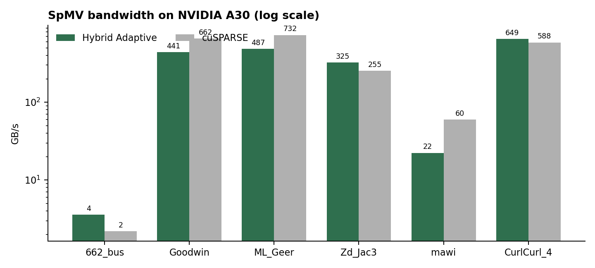
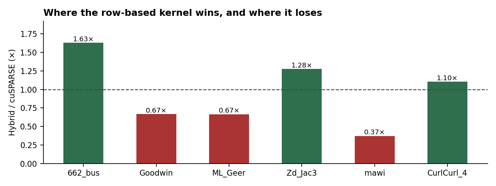

# cuda-SpMV

CSR sparse matrix-vector multiplication on an NVIDIA A30, with a hybrid adaptive kernel
(thread-per-row for short rows, warp-per-row for long rows) and a cuSPARSE baseline.
This is the Deliverable 2 work from the GPU Computing course at the University of Trento,
kept as a reproducible benchmark rather than a notebook.

The interesting result is not just the best number. It is that the row-based design **wins on
irregular matrices and loses badly on the 226M-row `mawi` graph**, and the reason for the loss is
measurable: more than 800,000 CUDA blocks and per-row scheduling overhead. That failure is what
led to the non-zero-based partitioning thesis.

## Results (NVIDIA A30, 24 GB HBM2, CUDA 12.5)

The table is the average over 50 timed runs (warm-up excluded). Raw data:
[`results/spmv_benchmark_results_second_deliverable.csv`](results/spmv_benchmark_results_second_deliverable.csv).

| Matrix | Rows | NNZ | Hybrid GB/s | cuSPARSE GB/s | Hybrid / cuSPARSE | Hybrid GFLOPS |
|---|---:|---:|---:|---:|---:|---:|
| `662_bus` | 662 | 1,568 | 3.6 | 2.2 | **1.63×** | 0.5 |
| `Goodwin_127` | 178,437 | 5,778,545 | 440.8 | 661.6 | 0.67× | 103.8 |
| `ML_Geer` | 1,504,002 | 110,879,972 | 487.1 | 732.2 | 0.67× | 118.6 |
| `Zd_Jac3_db` | 22,835 | 713,907 | 325.0 | 254.8 | **1.28×** | 76.4 |
| `mawi_201512020330` | 226,196,185 | 240,023,949 | 22.4 | 60.0 | **0.37×** | 2.1 |
| `CurlCurl_4` | 2,380,515 | 14,448,191 | **649.1** | 587.8 | **1.10×** | **122.1** |

`CurlCurl_4` is the defensible headline: 649 GB/s is **70% of the A30's 933 GB/s theoretical
peak**, and it beats cuSPARSE on a matrix with 14.4M non-zeros (larger than the 24 MB L2).
`662_bus` and `Zd_Jac3_db` fit in L2, so their ratios are flattered; `mawi` is the honest
counterexample. The CSV's baseline column is labelled `cublas`, but the code is
[`test/cusparse.cu`](test/cusparse.cu) — it is the cuSPARSE CSR baseline.





## Why `mawi` loses

`mawi` has 226M rows and only 1.06 non-zeros per row. The hybrid kernel assigns rows to warps or
blocks, which produces **more than 800,000 CUDA blocks** for this graph. The GPU spends its time
scheduling blocks rather than moving data. cuSPARSE's generalized scheduling is about 63% faster
there.

That diagnosis is the bridge to my M.S. thesis: if row-based work decomposition breaks on
irregular graphs, partition the non-zeros instead of the rows. My M.S. thesis, `dist-patoh`, does that for hypergraph partitioning. Code is private while
the thesis is being written.

## Implementations

CPU baselines:

- `spmv_cpu_csr.c` — one row per thread.
- `spmv_cpu_csr_ilp.c` — manual unrolling for instruction-level parallelism.

GPU kernels:

- `spmv_gpu_simple_csr.cu` — row-per-thread.
- `spmv_gpu_value_sequential_csr.cu` — value-per-thread with atomics (illustrative).
- `spmv_gpu_value_blocked_csr.cu` — value-parallel with strided access.
- `spmv_gpu_vector_csr.cu` — warp-per-row.
- `spmv_gpu_adaptive_csr.cu` — warp or block per row, chosen from row length.
- `spmv_gpu_hybrid_adaptive_csr.cu` — **the kernel in the table**: short rows use
  thread-per-row, long rows use warp-per-row; `__ldg()` for read-only loads and
  `__shfl_down_sync()` for warp reductions.

The experimental Hybrid V2 (sub-warp lane classes, huge-row splitting) is **not** part of this
main branch; it lives on `experimental/hybrid-v2` and is not used for the numbers above.

## Build and run

```bash
make                     # A30 / sm_80
# For another GPU, edit RELEASE_NV_OPT in the Makefile (e.g. sm_89 for L40S).
./scripts/download_matrices.sh
./scripts/run_all_benchmarks.sh        # Slurm
./scripts/run_spmv_hybrid_adaptive.sh  # one kernel
```

The measurement rules are in [`docs/methodology.md`](docs/methodology.md): verify every kernel
against the CPU reference, record the hardware and flags, report GB/s and GFLOPS together, and
never publish a row with a failed verification.

Hardware: AMD EPYC 9334 (32C/64T), NVIDIA A30 24 GB, CUDA 12.5.0.
